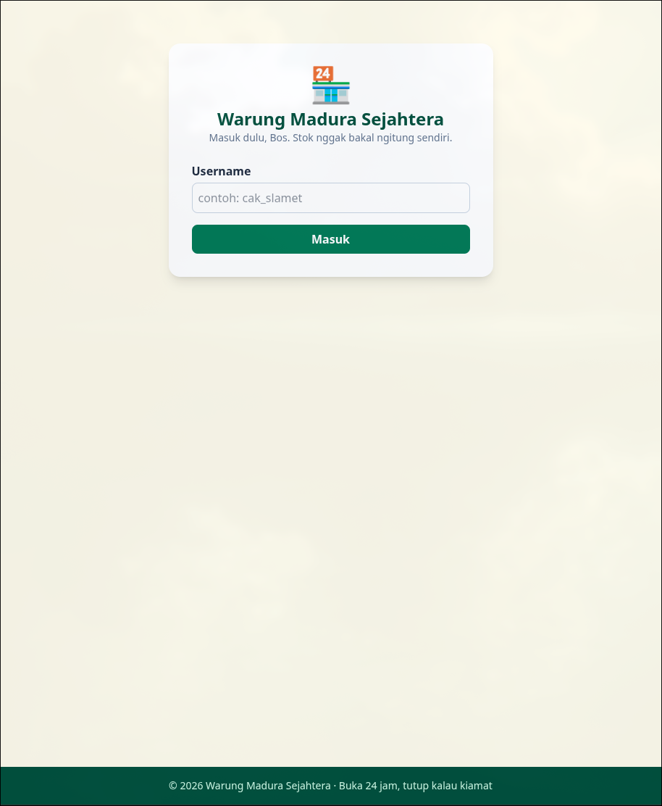
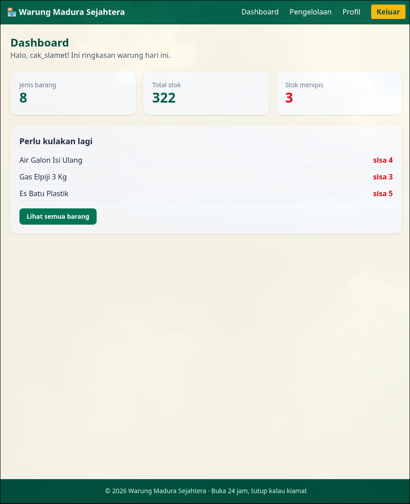
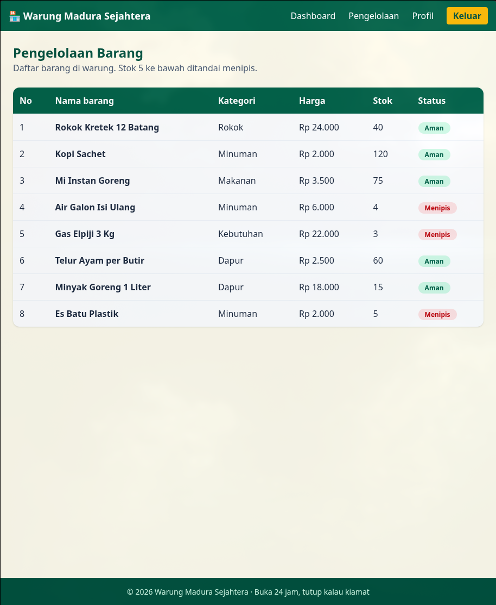
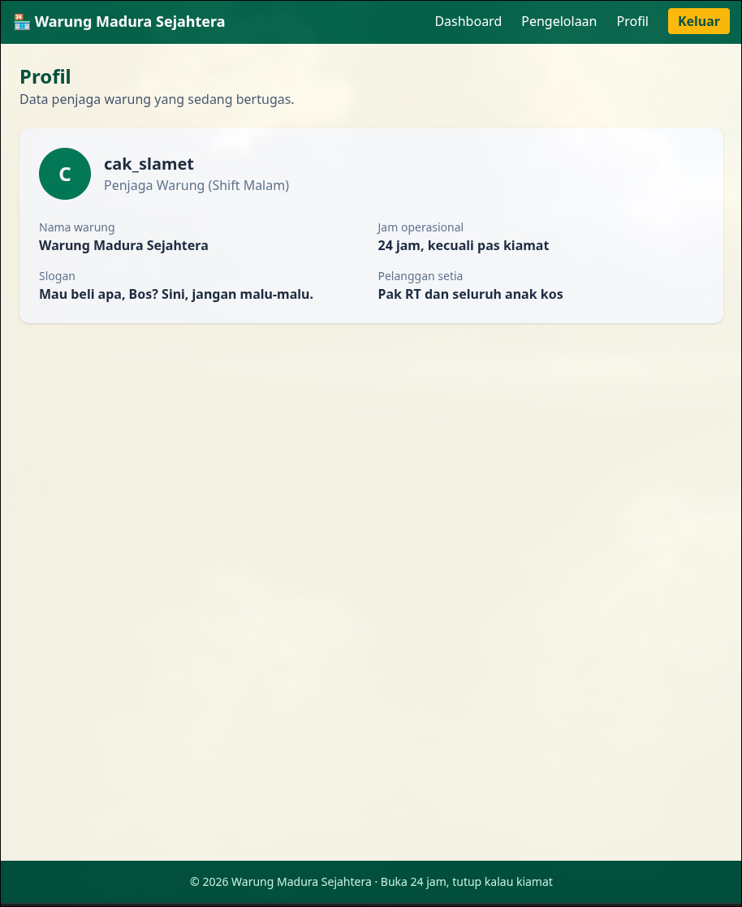

# Warung Madura Sejahtera

Aplikasi web simulasi pengelolaan warung Madura, dibuat dengan Laravel murni (tanpa database dan tanpa starter kit) memakai arsitektur MVC, Blade templating, dan Tailwind CSS.

Nama : Ahlul Fikri Firdaus
<br>
NIM : 252410102050
<br>
Kelas : Pemrograman Berbasis Web B

## Penjelasan singkat

Pengguna masuk dengan username, lalu username itu dikirim ke halaman lain lewat request parameter. Tersedia tiga halaman setelah login:

- **Dashboard**: ringkasan jumlah jenis barang, total stok, dan daftar barang yang stoknya menipis.
- **Pengelolaan**: tabel barang warung (data array dari Controller) lengkap dengan harga dan status stok.
- **Profil**: data penjaga warung yang sedang bertugas.

## Screenshot

### Login


### Dashboard


### Pengelolaan


### Profil


## Struktur utama

- `routes/web.php`: daftar route
- `app/Http/Controllers/PageController.php`: logika dan data
- `resources/views/layouts/app.blade.php`: layout utama
- `resources/views/*.blade.php`: halaman login, dashboard, pengelolaan, profile
- `resources/views/components/`: komponen navbar dan footer
- `resources/views/partials/judul.blade.php`: partial judul halaman

## Cara menjalankan

```bash
composer install
cp .env.example .env
php artisan key:generate
php artisan serve
```

Lalu buka `http://localhost:8000`.
